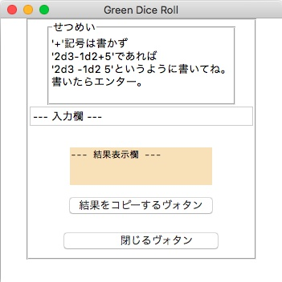
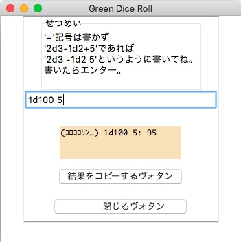

MyDiceRoll
===

tkinter でダイスロールをします。

- Docker: 対応!
- Python: 3.15! (3.14 でも動く)
- Linter: Ruff!
- Test: pytest!

## パッと実行してみたい

```bash
docker compose up --build
```

ブラウザで `http://localhost:6080/vnc.html?autoconnect=1` を開く。
入力欄に `2d3 -1d2 5` と書いてエンターを押すと、`(ｺﾛｺﾛﾘﾝ…) 2d3 -1d2 5: 7` のように合計が出る。
2 行目には `(2d3: 1, 3 / -1d2: 2)` のように、ダイスごとの出目が出る (ダイスが 1 個だけのときは出ない)。
結果が長くて結果表示欄に収まらないときは、横のスクロールバーで続きを見られる。

- `abc` や `1d0` のように読めない入力のときは、結果表示欄にエラーが出る。
- 「閉じるヴォタン」で終了すると、コンテナも止まる。
- コンテナはユーザー ID 1000 で動く。

画面なしで振るだけなら、引数に書く。読めない入力のときはエラーを出して終了コード 1 で終わる。

```bash
docker compose run --rm app python MyDiceRoll.py 2d3 -1d2 5
# (ｺﾛｺﾛﾘﾝ…) 2d3 -1d2 5: 7
# (2d3: 1, 3 / -1d2: 2)
```

## 書きかた

`+` 記号は書かず、項目をスペースで区切る。`2d3-1d2+5` であれば `2d3 -1d2 5` と書く。

- `2d3`: 3 面ダイスを 2 個振った合計
- `-1d2`: 2 面ダイスを 1 個振った合計を引く
- `5`: 5 を足す (`-5` なら引く)
- ダイスは全部で 1000 個まで、数は 6 桁まで
- 1 項目で 11 個以上振ると、その項目は出目ではなく合計が出る
- 全角で `２ｄ６　ー３` と書いても OK (`ー` や `−` はマイナスになる)
- テンキーのエンターでも振れる
- 入力欄をクリックすると `--- 入力欄 ---` は消える

## 開発

```bash
# lint とテスト
docker build --target dev --tag my-dice-roll-dev . && docker run --rm my-dice-roll-dev

# uv があるなら (テストには画面が要る。Linux なら xvfb-run uv run pytest)
uv run ruff check && uv run ruff format --check && uv run pytest
```




